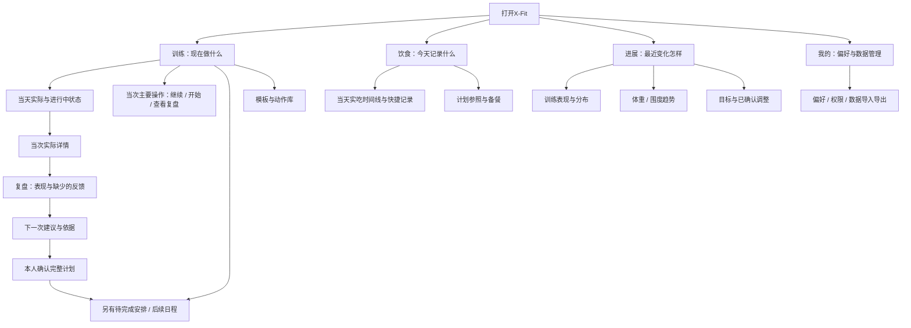

# X-Fit 进入后的页面结构：对标与优化建议

研究日期：2026-10-17，Asia/Shanghai。范围已获本人确认：“确认本地修复，完成后做对标研究”。日期状态修复已完成本地实现、相关单元/模拟器UI及无签名iPhoneOS构建；本文其余页面优化均为研究提案，手机尚未更新。验证与截图见[本轮结果索引](../test-results/20261017-training-day-status/validation.json)。

## 结论与适用范围

建议保留四个主入口，围绕“训练、饮食、进展、我的”明确分工：训练负责当次执行，饮食负责当天实吃，进展负责跨天判断，我的负责偏好和数据管理。优先统一实际记录与计划状态、改善训练反馈的采集，再考虑视觉调整。无需先重做配色、增加一个总首页或堆更多功能卡片。

这是一轮结构与任务路径研究，覆盖当前四个主入口及训练执行、日程、历史、计划管理。依据当前源码、本轮模拟器四个入口和训练状态截图，以及官方对标资料；模拟器采用隔离内存测试数据，图中体重、餐单和训练名称不代表本人的手机数据。本轮没有登录或购买竞品，没有逐一实测其全部付费页面，也没有取得本次手机四页截图。它支持形成优化候选，不能证明竞品整体更好或新结构已经提高使用效率。

## 当前App的实际结构

| 当前入口 | 当前主要内容与去向 | 已核实的问题或边界 | 建议职责 |
|---|---|---|---|
| 训练 | 周历、当天实际/继续训练、本周安排、计划导入、动作库、历史、跳绳 | 修复前日期状态只汇总日程，独立实际被遗漏，旧待完成安排会抢占大卡片；本轮已增加实际优先和单列待完成。首屏仍兼有执行、本周概览和管理入口 | 当天事实、当前最重要的一个操作，再向下管理其他安排 |
| 饮食 | 实吃照片时间线、餐食周回顾、三餐计划/手动记录、备餐、目标入口、全部记录 | 照片时间线与三餐计划是两组内容，需要理解“拍照”和“按餐单记录”的关系；当前已有未知营养不按零处理的正确边界 | 同一餐集中展示实际、可选计划参照和记录入口，其他管理下沉 |
| 目标 | 有减脂周期时显示体重轨迹、支持指标、肌群分布、营养目标与周期；无周期时显示创建引导及趋势入口 | 顶层名为目标，内容重心是减脂周期；已有训练表现不应依赖先创建减脂周期才能获得清楚入口 | 可考虑更名进展：训练与身体趋势均直接可看，目标作为其中一层 |
| 我的 | 个人设置与权限、训练历史、身体数据、更多记录工具、备份/导入/导出 | 主要是设置和数据管理，方向合理；历史入口在训练/管理/我的多处重复 | 保留管理职责，训练历史主入口放训练，其他保留快捷跳转即可 |
| 训练管理 | 日程入口、计划与动作、最近训练、本周进度 | 与训练页/进展页部分重叠；模板、某天安排和完成记录需要清楚区分 | 将模板/动作管理与按日安排分开命名，减少重复概览 |
| 训练中 | 实际组表、上次实际、计划目标、休息、可展开RIR与资料备注 | RIR已有能力，但主要组表根据详情展开状态显示；10/17实际17组均未填，聊天才取得两项末组余力 | 保留逐组快速记录，在动作末组提供可跳过的余力提示；技术动作采质量反馈 |
| 历史 | 完成场次列表、详情、补录，使用真实日期归属与旧时区未知提示 | 历史记录保留充分，但与当天入口/下一次计划的连接较弱 | 从当日实际进入详情，再进入复盘或复制为计划提案，保持事实与提案分离 |

现状定位：`FitnessApp/App/RootView.swift`、`Features/Today/TodayView.swift`、`Features/Redesign/NutritionHomeView.swift`、`Features/Redesign/GoalHomeView.swift`、`Features/Profile/ProfileView.swift`、`Features/Plan/PlanView.swift`、`Features/History/HistoryView.swift`、`Features/Workout/ActiveWorkoutView.swift`。这些是本轮读到的当前代码；不把README的旧页面描述当当前运行界面。四页截图见[本轮界面证据](../test-results/20261017-training-day-status/screenshots/)。

截图中可直接观察到：饮食页同时有上方拍照引导、底部拍照按钮及逐餐“按计划吃了/调整实吃”；目标页以13周减脂和体重图占据首屏，训练执行在下一层；我的页已将个人设置、记录工具、数据管理分区。饮食的多入口是否造成困惑、目标页是否让本人更难找到训练趋势仍属待验证假设，不仅凭截图认定使用失败。

## 四个对标的逻辑与结构

选择依据是与X-Fit任务的匹配程度及一手资料可核验性，不以官网评分、营销排名或“功能最多”选优。

本轮读取范围为下列官方公开说明的正文及Hevy的公开历史截图，检索日期均为2026-10-17。没有明确版本号的网页只代表当日可访问说明；同一产品的两篇文章用于互补对象和路径，不视为两条独立的效果验证。Strong、MacroFactor的旧文日期及截图访问限制分别在对应段落列出。

### Hevy：把可重复计划与实际训练分别组织

官方路径将已保存训练放在Profile历史中，Workout中的My Routines用于重复执行；实际训练可另存为Routine，日历可定位有训练的日期。主线是“选Routine/开始训练 → 逐组记录 → 保存为一场实际 → 历史/动作表现查看 → 可选择生成Routine”。[训练记录与复用](https://www.hevyapp.com/features/best-way-to-track-workouts/)、[进展与日历](https://www.hevyapp.com/features/gym-progress/)

值得借鉴的是对象清楚、保存后可以找到、从实际再生成计划有显式动作。官网展示的历史卡片包含名称、时间、容量和动作概要，并有独立Calendar入口；本轮已查看该官方截图。对X-Fit的对应改进是“实际训练卡”直接进入历史，旧计划另列；不能把一次做过的记录自动视为某条不同旧计划已完成。Hevy的社交信息流不是X-Fit当前的优先需求。

### Strong：训练中围绕一张记录表，模板本身不产生完成事实

Strong官方明确区分Template与Workout：模板中的组不能标记完成，没有实际完成日期；可从Start Workout创建模板，也可从History把真实训练另存为模板。其主页把记录训练与查看表现分开介绍。[模板与实际的官方说明](https://help.strongapp.io/article/105-about-templates)、[产品主页](https://www.strong.app/)

可借鉴的结构是“模板库 → 开始当次训练 → 记录实际 → 历史”，将编辑计划与执行计划的语义分开。对应X-Fit应继续保留已有的计划目标、上次实际与本次实际三层；需要改善它们的展示优先级，而非复制历史数字后直接给完成勾。帮助文档标注2021-05-20更新，适合验证对象关系，不能据此保证2026版每个按钮仍在相同位置。官方截图资源的直接访问被浏览器安全策略阻止，未绕过；视觉细节未独立核验。

### Fitbod：把计划设置与训练反馈连成下一次调整的入口

官方My Plan将目标、器械/场地、训练频率与时长、分化及动作偏好集中管理，入口为Workout → My Plan。RIR文档展示在训练中采集余力，并称其用于后续推荐；也允许从历史修改。[My Plan结构](https://help.fitbod.me/hc/en-us/sections/360012732693-Feature-Overview)、[RIR记录流程](https://help.fitbod.me/hc/en-us/articles/360033133174-Reps-in-Reserve-RiR-Formerly-Exertion-Rating-RPE)

可借鉴的是“设置约束 → 当次执行 → 最少反馈 → 下一次建议”的闭环，尤其适合X-Fit本次17组RIR缺失的问题：在动作结束时就提供可跳过反馈，结束后只补缺项。X-Fit仍需保留本人确认才写新计划的规则；官方描述不能证明Fitbod算法适合本人的组数、强度或恢复，也不支持把肌群恢复百分比当实测医学事实。

### MacroFactor：把当日记录、跨日趋势和策略调整分层

官方Dashboard将当天摄入/目标概览、趋势解释、记录习惯及更细身体/营养数据分层；Strategy集中目标、计划和周期检查。总览可进入对应数据详情，记录快捷入口与分析入口承担不同任务。[Dashboard帮助](https://help.macrofactorapp.com/dashboard/consistency/)、[Dashboard与Strategy设计说明](https://macrofactor.com/dashboard-revamp/)

对应X-Fit，饮食页先解决“今天记录了什么”，进展页解释“最近变化怎样”，目标/计划调整另有明确入口。保留原始体重、均值/趋势与估算值的区别；无记录或营养目标未确认时，不伪装成零摄入或可用剩余额度。设计说明标注2024-09-25更新，本轮与现存帮助文档交叉核对结构，未验证最新版全部像素或其算法效果；不引入其营养处方。

## 建议的信息架构

这是提案，不把skill当成已经在App运行的后台推荐器。复盘入口、下一次建议展示、暂停计时等未有完整产品能力的项目，需独立确认开发后才能出现在真实流程中。

## 训练首屏的状态与操作

| 当天情况 | 主状态 | 主操作 | 安排区域 |
|---|---|---|---|
| 正在训练 | 训练进行中 | 继续训练 | 原计划可查看，不覆盖当前实际 |
| 已结束且存在实际记录 | 已记录训练；部分工作组有据可查时展示X/Y | 查看记录；复盘能力落地后可进一步进入复盘 | 若仍有旧待完成安排，另外标明数量及内容 |
| 已结束但17/20组有记录 | 已记录17/20组 | 查看本次记录 | 保留未做的3组，不要求补齐或显示全部完成 |
| 独立补录实际与旧计划并存 | 已记录训练 | 查看实际 | 旧安排仍待完成，状态和关联均不自动更改 |
| 只有待完成计划 | 待开始/待完成 | 开始该计划 | 可调整或查看其他安排 |
| 没有计划和实际 | 暂无安排与记录 | 安排训练/补录 | 不以空白或0推定用户没有运动 |

本轮实现不把跳绳条目与力量场次擅自合并成“1次”，因此日级完整记录使用“已记录训练”。力量场次与跳绳原条目分别保留；跳绳次数未知仍按未知显示。

只读展示依据稳定UUID去重，按训练民用日期归属，不用读取时间或UTC午夜猜训练日期。周历的首要信号、当天卡片、日程页标题要采用同一套含义；仅改一个小图标仍可能让旧计划的大“开始”按钮继续误导。

## 有先后的优化候选

| 优先级 | 候选 | 解决的当前问题 | 可检查结果与范围 |
|---|---|---|---|
| P0，本次本地实现 | 实际状态与计划状态分开，周历/当天/日程一致；当天实际卡片优先 | 有实际训练却看起来没练；旧菜单抢占已完成当天的主要位置 | 10/15型独立记录可见，旧计划仍待完成；10/17型17/20不变成全完成；UUID、字段和关联保留；直接进入实际详情 |
| P1，后续提案 | 在实际详情后增加复盘和下一次建议入口 | 已能找到实际，但复盘及生成建议仍主要依靠聊天 | 从当前实际补缺少反馈，展示建议依据；完整新计划确认后写入，历史不受影响 |
| P1，后续提案 | 主项每组/辅助末组更容易填RIR，技术动作补快稳反馈 | 强度判断依赖聊天回忆 | 用户能在动作结束时轻点记录或跳过；未知保留未知，新增提示不阻断保存 |
| P1，后续提案 | 训练计时支持显式暂停，结束时分别展示墙钟与已记录暂停 | 回复信息等中断混入整课时长 | 今后有明确暂停记录才计算相应时长；不倒算或篡改10/17旧数据 |
| P1，后续提案 | 目标页改为进展入口，训练与身体并列，目标设置下沉 | 普通训练用户的趋势入口被减脂周期组织方式遮住 | 不创建减脂周期也能查看已有训练趋势；既有周期继续可见，指标来源与覆盖清楚 |
| P2，后续提案 | 饮食按同一餐组织实吃、照片、计划参照 | 计划与实吃双区域需要来回理解 | 能分清尚未记录、明确未吃、估算和已确认；不同来源不重复计餐 |
| P2，后续提案 | 模板/动作管理下沉，日期与状态文案统一 | 入口重复、中英日期混排、首屏任务分散 | 快速开始/继续/查实际仍在训练页，少用功能总菜单；视觉保留当前品牌基调 |

当天实际可见性和旧计划次要状态已纳入本次本地修复。全面重排首屏、改主入口名称及其余项目只停在研究提案，不借小修复实施整轮改版。

## 每个主入口建议先回答一个问题

| 页面 | 首屏先回答 | 第一层内容顺序 | 次级内容与典型路径 |
|---|---|---|---|
| 训练 | 我现在该做什么，刚才是否已保存？ | 选定日期与实际状态 → 继续/开始/查看实际 → 其他待完成安排 | 下次安排、本周、模板动作管理；实际详情 → 补反馈 → 建议 → 确认计划 |
| 饮食 | 今天实际记了什么，还有哪些未记录？ | 当天实际摘要 → 一条记录入口 → 各餐实际/待记状态 | 计划作为同餐参照，周回顾与备餐下沉；拍照和手动记录汇入同一餐，不重复计入 |
| 进展（当前“目标”） | 最近训练和身体怎样变化，哪些证据不足？ | 训练/身体两个趋势入口 → 日期范围与数据覆盖 → 指标详情 | 目标与周期设置；查看上次同动作 → 实际组/单位/余力依据，避免只看总吨位排名 |
| 我的 | 我的偏好、权限与数据在哪里？ | 个人偏好与权限 → 记录工具快捷入口 → 导入导出与备份 | 维持当前分区；减少与训练页重复的概览，保留跨页快捷入口 |

这不是要求每页只有一个按钮。首要任务应清楚，次级管理仍可到达；优先用现有组件调整层级，是否重排要由真实任务验证决定。对当前本人需求，建议先验证“训练后的反馈闭环”，再验证进展页组织，随后统一饮食的同餐入口，视觉微调靠后。

## 反向检查与最小验证

- 更多入口不一定更快。当前四Tab和大触点已有清楚基础；先试状态、排序和文案，只有真人仍找不到关键任务时才扩大改版。
- Hevy偏社交，Fitbod偏自动推荐，MacroFactor专注营养；它们的商业目标和X-Fit不同，不复制整套首页、订阅提示或算法。
- 本轮只验证官方公开能力与结构，未证明竞品采集更完整、推荐更准确或用户留存更高；“优秀”限定为有具体可借鉴机制。
- 本次修复验证应覆盖：独立补录+旧计划、独立补录无计划、关联训练部分组、关联完整训练、进行中、跳过/丢弃、跨日/时区和相同UUID去重；展示计算前后不调用数据保存或改变关联。
- 后续结构候选先做三条真人普通路径：打开后继续训练；练完后找到刚才实际并补一项余力；隔天找到上次同动作和下一次安排。候选通过标准为三条均可无提示完成、没有把旧计划误当成未训练的主要入口、原始记录不受影响；记录耗时和返回次数与现有版本比较。若任务未完成或误解状态，先改层级/文案，再考虑扩大改版；不把点击数或文档完成视为使用效果。
- 新页面改动、竞品导航调整、真实任务测试反证或用户目标改变时重评；关键数据未知、跨单位或恢复算法没有依据时，停止将其包装为确定建议。
