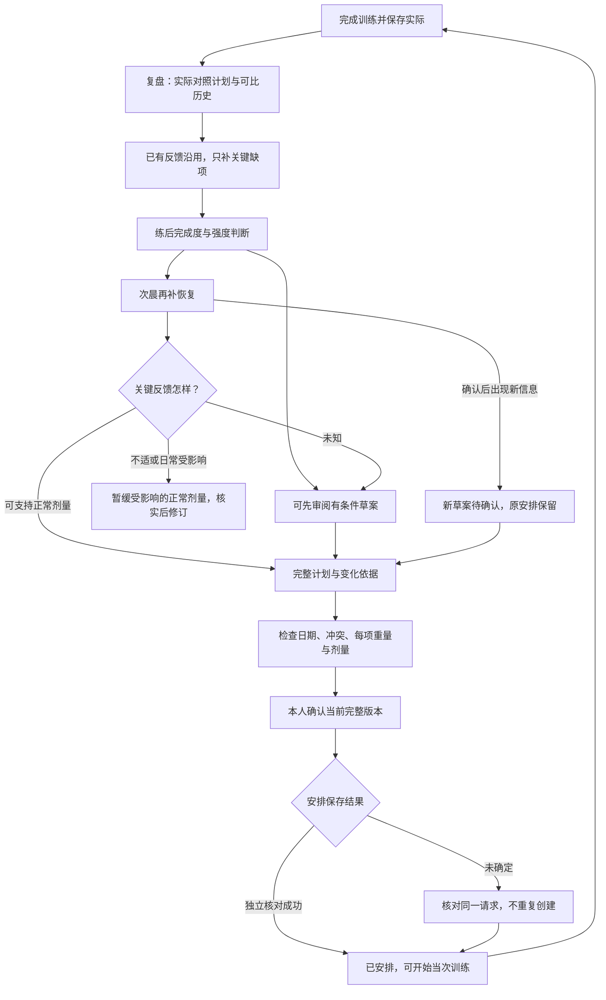

# X-Fit 四个主页面与训练反馈闭环 · A方向V3优化原型（已确认开发）

**当前状态补注（2026-10-18）：本人已明确确认按A V3开始开发。原生实现、历史保护和验证结果统一维护在[正式需求REQ-20261017-235901](../../docs/requirements/2026-10-17/235901_editorial-v3-training-loop.md)。下文“原型未修改App/等待确认”等文字保留形成当时的边界，不代表当前开发状态。**

**原生视觉返修（2026-10-18）：本人否定首轮原生视觉；本地已按原选A修正版式与导航，视觉仍待本人审阅。[实际四页与修改前后对照](../prototypes/2026-10-17-main-pages-v1/visual-review.html)展示模拟器隔离数据，当前验证统一回写上述正式需求。**

日期：2026-10-17。交付范围：优化方案、可点击独立原型及本轮试走结论。**等待本人审阅确认后再开发App**；本轮没有修改生产Swift代码、配置、模型、训练档案或手机数据，也没有创建已确认开发需求、安装、提交或发布。

- [打开单文件原型](../prototypes/2026-10-17-main-pages-v1/index.html)：双击即可运行，不依赖服务器或网络；状态只在内存，刷新重置。
- 本机预览地址：`http://127.0.0.1:55853/`，只在当前Mac可用，预览进程停止后改用HTML文件。
- [上一轮对标报告](2026-10-17-app-entry-benchmarks.md)保留为来源；本文负责本版方案及确认范围，避免重复维护两份方案正文。

## 当前交付：沿已选A继续优化

本人已反馈“A蛮好”，后续要求继续优化。该反馈确定A为主视觉方向；本轮进一步修改同一独立原型，不视为App开发、安装或发布确认。B/C保留为比较参考。

| 位置 | V3实际修改 | 评审重点 |
|---|---|---|
| 四个主页 | 保留暖白、运动摄影、大字与荧光绿主操作；页标题缩为训练/饮食/进展/我的，统一间距、圆角和导航选中态 | 不靠缩小主体字体压低信息密度；四页内容各有重点 |
| 训练 | 实际17/20独立主视觉；复盘/恢复/计划三步短状态；主操作随阶段切换；下一次计划与旧计划另列 | 已练、草案、已安排、保存待核对不能混淆 |
| 饮食 | 已记录餐数与待确认分开；一张主餐照片、一个记录入口、三餐状态条；修正A餐数随午/晚餐实际状态计算 | 待确认不计已记录；重复确认同餐不增加餐数 |
| 进展 | 同机腿举105kg/侧、10次和末组余力同屏；同重同次比较与最近训练压成短条 | 余力信息更完整不等于已证实力量增长 |
| 我的 | 身份、一个偏好摘要、四个常用入口；权限/数据放次级 | 不堆设置说明和重复跳转 |
| 复盘 | 一句结论和三个调整重点；依据、已知反馈默认折叠；动作详情返回原来的复盘或计划 | 首屏可见三个重点，底部下一步可达 |
| 恢复与计划 | 一次一题，增加返回上一题并保留答案；完整计划直接显示重量、记重口径、组次、余力/技术目标和休息；热身/依据/调整点开看 | 缺恢复先补恢复；已补但未选日期/核对或有日期冲突时禁用确认；旧确认版本保留入口 |

入口：[A优化版四页](http://127.0.0.1:55853/?variant=A&view=overview)、[A交互预览](http://127.0.0.1:55853/?variant=A&view=single)。也可双击[HTML文件](../prototypes/2026-10-17-main-pages-v1/index.html)。图片已内嵌，刷新/重置清空演示状态。

原型目录沿用V1路径；方案和原型均在同一文件持续更新。训练剂量仍引用既有10/17复盘02候选，本轮没有创建新处方或改动训练档案。

### V2视觉探索（历史参考）

V2根据“字展开太多、整体没有设计感”的反馈重做了三种结构：A运动画报，B数据仪表，C留白与节奏。本人选择A后，当前视觉以本节V3和实际HTML为准。B/C不作为后续开发方向。

## 1. 本版要回答的问题

本人已经在App记录实际训练，希望不用重抄重量/次数，练完就能看到实际与计划的差异，只补会影响判断的反馈；下一次计划应有具体重量、剂量和依据，并在完整确认后加入日程。最高优先验证：本人能否分清**已经发生的事实、尚缺的反馈、有条件的草案、自己确认的版本和真正保存的安排**。

建议保留四个主入口，组织为“训练、饮食、进展、我的”，当前沿本人偏好的A方向，使用暖白、运动摄影、大字、荧光绿主操作与大触点。重心是主任务顺序、状态和反馈衔接；不增加总首页、社交信息流、付费体系或未经验证的恢复分数。

原型是交互与信息结构验证，训练详情采用已有10/17复盘02候选。它不计算新的训练处方，不代表草案已被本人接受，也不证明该方法提高训练结果。

## 2. 当前事实、示例与来源

| 类型 | 已核对内容 | 本版怎么使用 |
|---|---|---|
| 当前本地代码 | RootView四Tab；Today/Schedule的实际与计划分离修复；ActiveWorkout的实际组/RIR；NutritionHome、GoalHome、Profile；已有单日计划导入入口 | 保持实际/计划分离和历史保护；对四页职责提出新方案。源码支持某字段不代表已填，也不证明本轮已在手机运行 |
| 已取得的10/17实际 | 20个计划位置、17条完成：4高翻技术、13常规下肢；死虫3组本人确认未做。App逐组RIR为空 | 作为复盘示例，不改写原始完成组；未做不补课，不将20个计划位置全称有效抗阻组 |
| 本人随后补充 | 腿举105×10末组RIR至少5，腿屈伸50×10末组3–5；单手30扶架；高翻末组稳定；训练前夜睡眠差；回消息有中断 | 原型直接沿用，独立标来源，不再次逐项询问，不回填成其他组的RIR |
| 尚未知 | 10/18次晨恢复；部分动作余力、杆重/机器物理计量等 | 尚未发生的次晨保持待补；旧的不确定字段可以保留未知，不阻断可独立完成的分析 |
| 演示新增 | 正常/不适的次晨反馈、10/22及10/24日期、日期冲突、保存回执、饮食与体重输入 | 均为原型内存状态，不是本人真实记录或新日程；示例日期不等于自动排下一周 |

依据：[10/17复盘02](../training-review/2026-10-17-lower-body-review.md)、[力量档案STR-20261017-04](../../docs/training/力量表现档案.md)、[方法METHOD-20261017-04第6节](../../docs/training/训练编排方法.md)、[App偏好及本地组数输入](../../docs/training/用户训练偏好.md)。本轮只复核本地证据，未重读手机；源复盘保留形成时的小时钟诊断，后续本地修复以[REQ-20261017-171939](../../docs/requirements/2026-10-17/171939_training-day-status-benchmarks.md)为准。

## 3. 四个主页面

| 页面 | 首屏要回答 | 首屏顺序与主操作 | 下沉入口及主要状态 |
|---|---|---|---|
| 训练 | 现在该做什么，刚才是否已保存？ | 日期/周历 → 当天实际或进行中 → 当前最重要的下一步 → 下次草案/已确认安排 → 其他安排 | 实际详情、复盘、补反馈、完整计划、日程、模板动作、历史。进行中优先“继续”；练完优先“查看复盘”；无安排显示安排入口。旧planned另列，保留小时钟 |
| 饮食 | 今天实际记了什么，哪些仍待确认？ | 当天实际摘要 → 一个“记录一餐”主入口 → 同餐的照片、文字、份量与可选计划参照 | 未记录、待确认、已确认、明确未吃分开；照片和手工补充归同餐。周回顾与备餐下沉；营养未知不显示0摄入或剩余额度 |
| 进展 | 最近训练和身体怎样变化，证据是否可比？ | 训练表现/身体趋势切换 → 日期和覆盖 → 同口径表现或趋势 → 原始记录/复盘 | 训练趋势不依赖先创建减脂周期；目标与周期设置放次级。不同器械、单位和性质不混算增长；身体覆盖不足时不制造趋势 |
| 我的 | 偏好、权限和数据在哪里？ | 训练偏好/权限 → 记录工具 → 数据管理 | 保留当前合理分区。历史可作快捷入口，训练页仍是主要使用路径；偏好追加版本，不覆盖旧规则 |

“进展”替换的是主入口名称及组织重心，已有减脂周期、目标、身体记录和历史均保留。照片/手工记录同餐归并是后续开发需要明确身份与关联的产品规则，原型只展示显式选择同餐后的结果，不假定自动跨来源去重已可用。

## 4. 训练后的闭环

图中“可先审阅”不等于可跳过关键恢复直接确认正常剂量。缺项只影响对应草案，不能阻断其他页面、原始记录或其他已确认训练。是否允许显式确认带条件的保守日程，可在本人评审后另调；本版采用“先看草案，关键恢复足够后再定正常剂量”。

### 4.1 练后：先复用，再补充

App先取得场次、实际组、原处方、动作质量/感受及已有身体/睡眠信息。复盘页同时显示原始实际和来源明确的补充反馈。

- 常规主项优先逐工作组RIR，辅助至少末组；已经有的字段不重问。
- 爆发技术动作采快稳/接杠质量，不强求用RIR解释。
- 只在确实缺少且会改变决定时追问：为什么少做/换动作、哪里不适、动作是否失稳、末组大概余力。
- 允许跳过与“不清楚”。不能把处方目标、表情或历史预填当作真实RIR；练完保存不以答完问卷为条件。
- 原型的10/17已知反馈直接沿用；“死虫省去原因、箭步蹲末组余力”只是可选演示，不继续索要所有旧数字。新增足以改变处方的信息会使原候选待复核，本原型不会假装已经自动计算出有效新剂量。

### 4.2 次晨：不把未发生当正常

核心字段是关节/腰背或动作诱发不适、走路/楼梯/蹲起、整体恢复；局部酸痛和训练后当晚睡眠可补充，允许未知。有不适或功能受影响时展开部位与活动说明。

原型明确区分10/17训练前夜睡眠与10/17训练后的当晚睡眠；不把前者归因于本次课。此处不生成恢复百分比、不做医学判断。默认仅App内待补入口；通知属于可选设置，本轮未设置提醒。

### 4.3 复盘如何转成下一次

复盘先看实际重量/次数/余力、同口径历史、最近7天实际与后续活动，再区分维持、现场校准、跨课进阶、容量或技术问题。一次轻松、总吨位或没酸痛不自动触发加量。

每个计划动作必须可展开查看：历史锚点与日期、计量口径、首组和后续组、热身、目标次数/余力或技术质量、休息、当天调整/停止条件、缺项和置信度。维持也说明理由。原型完整呈现已有6项、20个计划位置的候选，重量来自已形成的复盘02，不新增真实处方。

### 4.4 确认的是完整版本

- 草案、确认和保存分开。无日期、未检查完整版本、受影响的关键恢复未知或日期冲突时，保留草案并说明原因。
- 确认页面须包含全部动作、剂量、计量与日期，不能只确认一个摘要后再静默改变重量或动作。
- 新反馈改变剂量或日期时，旧确认不沿用到新版；原已确认安排继续保留。再次保存相同反馈不凭空增加版本。
- 日期冲突时保留原安排，改选日期或进入明确的独立处理；本原型选择改选日期，不自动覆盖/跳过/改绑。
- 已确认但保存回执未知时显示待核对；检查同一版本后再判成功，不重复创建。真实开发须重读源版本和目标日程，并通过现有支持入口写入、独立回读。

## 5. 数据与能力边界

| 对象 | 数据所有权/保存原则 | 当前与待开发能力 |
|---|---|---|
| 实际训练 | WorkoutSession/SessionExercise/SetLog及原身份、日期、侧别、单位、完成状态不被复盘覆盖 | 现有；本轮只用本地已取得快照 |
| 补充反馈 | 绑定场次、动作/组或训练日，保留来源、发生/取得日期、已知/未知和更正关系 | 现有RIR、感受、备注和身体状态可读；专用的补充反馈与两阶段复盘状态需要设计持久化方案 |
| 复盘 | 记录所用实际、反馈和偏好版本；原始事实与解释/候选分开 | 当前主要是skill与本地文档，不是App后台已部署的教练引擎；需要App入口及受控分析连接 |
| 草案 | 保存完整处方、依据和来源版本，追加修订 | 现有单日导入可保留逐组目标；从复盘生成/展示/修订的完整产品链需开发 |
| 确认与保存 | 绑定不可变的草案版本、日期及操作身份；变化后重新审阅；保存与回读分别记录 | 本原型仅模拟；真实幂等、冲突、重读及结果恢复必须沿用项目约束验证 |
| 饮食 | 同餐内照片/文字/计划参照显式关联，未知营养保留；历史来源不删 | 原型演示午/晚餐独立，重复确认同一餐不增加餐数；生产归并及历史兼容需确认实现映射 |

不在本轮做偏好升级、旧计划批量撤销、历史去重、Schema迁移、自动下一周排程、云端分析接入、通知订阅或真实设备同步。这些能力若后续实施，应在获确认的对应需求内明确目标、迁移/回滚、权限和分层验证。

## 6. 原型怎么审阅

默认四页概览；点击任一页面的主操作进入交互预览。四Tab自由切换，底部A/B/C或左右箭头切换视觉方向；键盘左右键同样可用，输入字段内不拦截。右上角可回概览或重置。底部“⋯”展开原型情景，默认不占主界面。

仅保留当下需要的内容：复盘依据和反馈按需展开；计划的热身与调整逐项点开；恢复按三个问题逐步填写，可保留未知。切换视觉不清空本页演示状态；刷新或重置会清空，未连接App。

| 评审任务 | 看什么结果 | 不通过时怎么改 |
|---|---|---|
| 打开练完首屏找到刚才实际和复盘 | 看懂17/20及旧计划另列；不误点旧计划当主要任务 | 先调状态、标题与排序 |
| 使用已有反馈并跳过未知 | 不重抄重量，不强迫补精确旧RIR；仍能查看其他页面 | 减少追问和必填项，改反馈时点 |
| 未取得次晨反馈时看下一次草案 | 看懂“可以看”和“尚未确认正常剂量”的区别 | 改主操作和缺项说明，讨论是否允许有条件安排 |
| 正常恢复后审阅、选日期并确认 | 全6项处方可查看；确认绑定当前版本；日期冲突不覆盖 | 调整完整计划层级与冲突处理 |
| 确认后补充新反馈 | 原安排保留，新草案待核实/确认，历史不改 | 调整版本与反馈关系 |
| 保存结果未知后核对 | 不误称成功，不生成重复安排 | 明确待核对状态与恢复动作 |
| 同一餐补照片与文字再确认 | 输入仍在，餐次不重复，午餐/晚餐分开 | 改同餐身份、编辑与确认路径 |
| 从进展查看训练与身体 | 不创建减脂周期也能看训练入口；缺数据不制造曲线 | 调整入口名及覆盖提示 |

本人可优先反馈三件事：四页职责是否顺手；两次补反馈的节奏是否接受；完整计划是否容易核对并确认。通过标准是普通路径可无提示完成、不会误解状态/来源、历史不会被新建议替代；更快、更省心等使用效果仍需本人体验验证。

## 7. 确认后的开发建议与验收范围

建议先完成一个可使用的批次：四个主入口的职责与导航调整，加上“实际 → 复盘 → 关键反馈 → 完整草案 → 当前版本确认 → 安排结果”的训练闭环。饮食同餐编辑与进展深层图表可分别作为后续批次；分批范围由本人确认，不能把本原型自动视为全量开发授权。

正式需求确认单应覆盖：目标与非目标、现有数据边界、与旧规则的冲突、反馈/草案/确认的保存关系、验收ID及单元/模拟器/真机/真人层。当前没有冲突处置授权：新名字不废弃旧周期，独立反馈不回填旧完成组，正常3/4组偏好与既有进阶不被改变。

建议验收：已有实际不重录；关键未知不补零/正常；补充反馈带来源且不覆盖原始组；动作/计量不兼容不套重量；确认后变更需新版；冲突保留旧项；同包重入不重复创建；保存未知可恢复核对；完成训练不受问卷阻塞；正常字体与大字主操作可达。设备安装与真实数据守恒另按明确授权执行。

## 8. 验证与限制

### V3本轮观察

- 实际点击复盘→草案→次晨三题→保存反馈→完整计划→日期/勾选→确认，显示10/22演示安排；回训练页主操作改为查看已确认安排，原17/20与旧计划入口仍在。未写App。
- 返回上一题后“没有不适”仍选中；未知反馈可保留；日期/完整审阅缺项或日期冲突时确认禁用。保存回执未知先显示待核对，检查后进入同一版本已安排结果。
- 从复盘打开腿举详情后可返回训练复盘；详情明确首组12、后3组各10–12、RIR2–3与休息120–180秒。六项重量和剂量未重新制定。
- 新恢复反馈产生待核实V2时，原10/22的V1仍有独立入口；修改草案为10/24后，旧入口仍打开10/22 V1的只读完整快照，六项处方、余力/技术目标和休息仍在。修复了旧安排的完整计划入口误跳当前草案的问题，确认时在本页内存中复制处方快照。
- 午餐确认前已记录1餐，确认后2餐；再次打开同餐确认仍2餐。营养未知不填0。
- 手机宽度实际390 CSS像素时，页面、内容和内容滚动宽度均390，切换栏331；底部主按钮位于可视区域。已恢复默认视口并重置为A四页概览。
- 内嵌脚本`node --check`通过，本轮观察控制台无error。一次性原型没有新增自动化测试，不代表App回归或真人接受。

V3截图：[四页优化](../prototypes/2026-10-17-main-pages-v1/screenshots-v3/A-overview.jpg)、[复盘首屏](../prototypes/2026-10-17-main-pages-v1/screenshots-v3/review.jpg)、[计划](../prototypes/2026-10-17-main-pages-v1/screenshots-v3/plan.jpg)、[单题反馈](../prototypes/2026-10-17-main-pages-v1/screenshots-v3/feedback.jpg)、[已安排首页](../prototypes/2026-10-17-main-pages-v1/screenshots-v3/training-confirmed.jpg)、[原确认完整快照](../prototypes/2026-10-17-main-pages-v1/screenshots-v3/saved-version.jpg)、[窄屏复盘](../prototypes/2026-10-17-main-pages-v1/screenshots-v3/narrow-review.jpg)。均为浏览器内存原型，截图中的餐食、恢复填写和新安排是演示。

范围仍为可点击优化原型。本人对A的偏好已取得，V3可用性和后续开发范围仍待审阅；未新增正式开发需求、生产代码修改、安装或发布。

### V2本轮形成时的记录（历史）

V2形成时实际点击：三种视觉的四页概览、复盘默认折叠/手动展开、单题恢复反馈、六项紧凑处方、日期与完整计划勾选确认。390 CSS像素下页面与内容总宽均为390，切换栏331像素，无横向溢出；主操作固定可达，默认视口已恢复。确认结果显示本页演示安排，原始17/20仍保留；未把排版精简当作App开发或真人接受。

V2截图：[A四页](../prototypes/2026-10-17-main-pages-v1/screenshots-v2/A-overview.jpg)、[B四页](../prototypes/2026-10-17-main-pages-v1/screenshots-v2/B-overview.jpg)、[C四页](../prototypes/2026-10-17-main-pages-v1/screenshots-v2/C-overview.jpg)、[单题反馈](../prototypes/2026-10-17-main-pages-v1/screenshots-v2/feedback.jpg)、[精简复盘](../prototypes/2026-10-17-main-pages-v1/screenshots-v2/review.jpg)、[窄屏复盘](../prototypes/2026-10-17-main-pages-v1/screenshots-v2/narrow-review.jpg)。

### V1形成时的记录（历史，不代表当前视觉）

本轮通过浏览器实际点击检查主流程、恢复未知、日期冲突、确认后新反馈与回执核对；使用手机框内的日期、完整审阅勾选和确认按钮完成演示安排。饮食试走保留文字后补演示照片，再确认同一餐，未增加重复餐。原型脚本语法检查通过；本轮没有为一次性原型新增自动化测试套件，也不以原型检查替代App回归。

观察结果：关键恢复未知时确认保持0条安排；日期冲突时保持0条且原项不改；另选日期后形成1条已安排；新增有变化的恢复后显示V2未确认、原V1安排仍1条；回执未取得时显示0条已安排/1条待核对，核对后变为1条，没有新增第二条。窄屏实际布局390 CSS像素，页面总宽390、手机内容宽363/滚动内容宽363，无横向溢出；大字模式的计划可滚动阅读。默认视口已恢复。

原型截图：[训练](../prototypes/2026-10-17-main-pages-v1/screenshots/01-training.jpg)、[饮食](../prototypes/2026-10-17-main-pages-v1/screenshots/02-food.jpg)、[进展](../prototypes/2026-10-17-main-pages-v1/screenshots/03-progress.jpg)、[我的](../prototypes/2026-10-17-main-pages-v1/screenshots/04-profile.jpg)、[复盘](../prototypes/2026-10-17-main-pages-v1/screenshots/05-review.jpg)、[完整计划入口](../prototypes/2026-10-17-main-pages-v1/screenshots/06-plan.jpg)、[确认结果](../prototypes/2026-10-17-main-pages-v1/screenshots/07-confirmed.jpg)、[窄屏大字](../prototypes/2026-10-17-main-pages-v1/screenshots/narrow-large-plan.jpg)。截图均为本地原型，包含演示反馈/安排，不是App真机截图。

目前支持的结论仅是：原型中的状态和导航可以按所列情景操作；尚未取得本人的可用性反馈，也没有App代码、持久化、计划分析服务、真实导入、设备、通知或医学有效性验证。原型结构若让本人感觉反馈过重或草案入口仍不清楚，优先简化层级与提问，未确认前不进入App开发。

对标迁移沿用上一轮当日官方资料，仅作为结构候选，不把竞品先例当个人效果证据。另参考本轮只读展开的待验证知识`synthesis_68a7e374e92c5304d8f1efead353a941`（provisional/unverified），仅用于把最高风险的状态假设放进原型验证；不将其提升为已验证产品方法，不保存新知识。

依据[AGENTS.md](../../AGENTS.md)：“只有用户明确确认后，才能在docs/requirements/YYYY-MM-DD/下创建正式需求文件并开始修改代码、配置或产品数据。”当前交付的是本人直接请求的独立方案原型；后续App开发等待本人明确确认。
